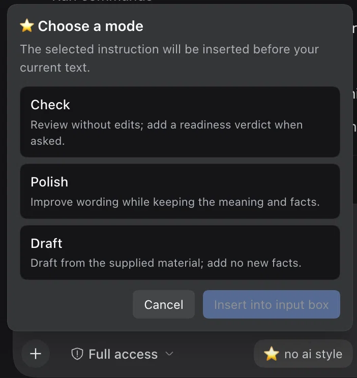

[English](README.md) | [中文](README.zh-CN.md) | [日本語](README.ja.md)

# No AI Style

**自然な文章、原意に忠実な編集。**

Skill v1.0 · DSH プラグイン v1.1.0 · 英語 / 中国語 / 日本語 · 作者：[01NGVI-QINGYI](https://github.com/01NGVI-QINGYI)

学術文書や業務文書のための agent skill で、DeepSeek Harness プラグインとしてもインストールできます。
機械的な表現や不要な前置きを減らし、事実、引用、必要な留保、著者の文体を保ちます。

**編集前：** 明確に説明するために述べておくと、この機器には USB ポートが二つあります。

**編集後：** この機器には USB ポートが二つあります。

## インストール

Node.js と npm が必要です。

**Codex**

```bash
npx skills add 01NGVI-QINGYI/no-ai-style --global --agent codex
```

**Deepseek Harness**

DSH Desktop の **Settings → Plugins** で `github:01NGVI-QINGYI/no-ai-style` を追加します。CLI からは次のコマンドでインストールできます。

```bash
dsh plugin --profile web add github:01NGVI-QINGYI/no-ai-style
```

`--profile` には実際に使っているプロファイルを指定します（`dsh web` なら `web`、デスクトップアプリなら `desktop`）。プラグインは独自の skill provider を登録するため、プロジェクト・カスタム・ユーザーの各 skill ディレクトリには触れず、そのプロファイルの全セッションでスキルが使えます。

インストール後に DSH を再起動してください。通常の agent skill として入れる場合は、Deepseek Harness のプロジェクト内で次を実行すると `.agents/skills` にインストールされます。

```bash
npx skills add 01NGVI-QINGYI/no-ai-style --agent universal --copy
```

**Claude Code**

```bash
npx skills add 01NGVI-QINGYI/no-ai-style --global --agent claude-code
```

**Pi**

```bash
npx skills add 01NGVI-QINGYI/no-ai-style --global --agent pi
```

**Cursor**

```bash
npx skills add 01NGVI-QINGYI/no-ai-style --global --agent cursor
```

**Other agents**

```bash
npx skills add 01NGVI-QINGYI/no-ai-style
```

画面の案内に従って選択してください。`--global` を省略すると現在のプロジェクトにインストールします。

手動の場合は `skills/no-ai-style/` をエージェントの skills ディレクトリにコピーします。

## 使い方

インストール後、自然な言葉で依頼します。本文を貼り付けるか、ファイルのパスを指定してください。

```text
no-ai-style で確認してください。
no-ai-style で推敲してください。
no-ai-style で草稿を作成してください。
```

「確認」は通常のレビューにも提出前チェックにも使えます。提出可能か尋ねると、判定と未解決の問題も示します。

DSH の入力欄には **no ai style** ボタン（⭐ no ai style）があります。クリックして「確認」「推敲」「草稿」を選びます。挿入すると指示が既存の草稿の先頭に追加され、キャンセルすると変更しません。表示言語は DSH の言語に従い、日本語は DSH で日本語ロケールが有効な場合に使われます。旧バージョンでは、ファイルやコマンドの参照が草稿に含まれると、参照を失わないよう挿入を停止します。

<p align="center">
  
</p>


| モード | 出力 |
| --- | --- |
| `audit` | 問題と提案。提出可否を尋ねた場合は判定と未解決事項も示し、元のファイルは変更しない |
| `revise` | 指定した範囲の編集稿 |
| `compose` | 提供されたメモと根拠に基づく草稿 |

標準は軽い編集です。大幅な書き直しが必要な場合は明示してください。
原文の言語に従い、適切な表現はそのまま残します。
根拠の不足は `[EVIDENCE GAP]`、著者の判断が必要な解釈は `[INTERPRETATION FLAG]` で示します。

## 任意の確認

Python 3.9+ が必要です。外部パッケージは不要です。リポジトリのルートで実行します。

```bash
python3 skills/no-ai-style/scripts/audit_prose.py draft.md --lang auto
python3 skills/no-ai-style/scripts/compare_anchors.py before.md after.md --format json
```
スクリプトはローカルで動作し、本文をアップロードしません。結果は文脈に照らして確認してください。
未閉鎖のコメントやコードフェンスは警告されます。`--strict` を付けると、根拠不足のマーカーや
未閉鎖の書式に対して終了コード 1 を返します。

目的は読みやすさの改善であり、AI 検出の回避ではありません。詳細は [SKILL.md](skills/no-ai-style/SKILL.md) を参照してください。

## ライセンス

[MIT](LICENSE) · 作者：[01NGVI-QINGYI](https://github.com/01NGVI-QINGYI)。
