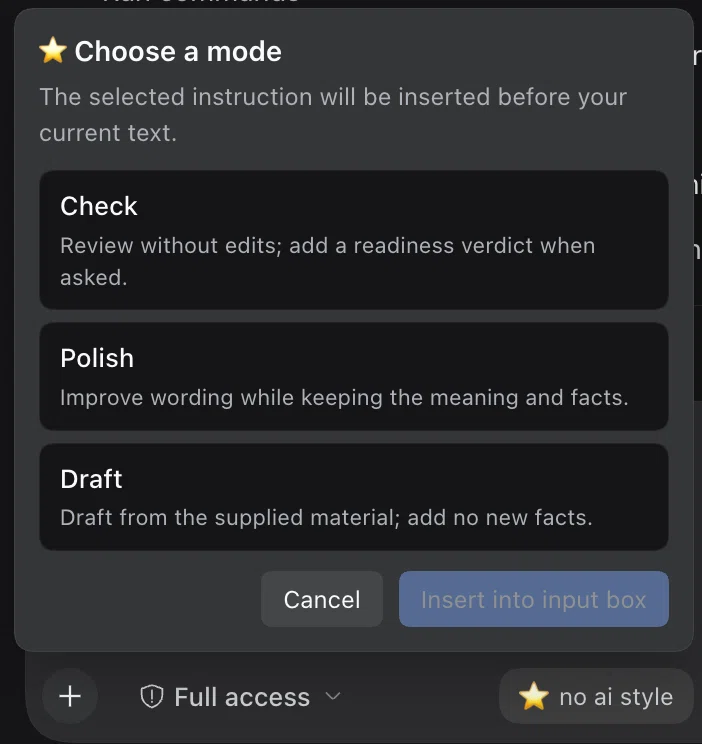
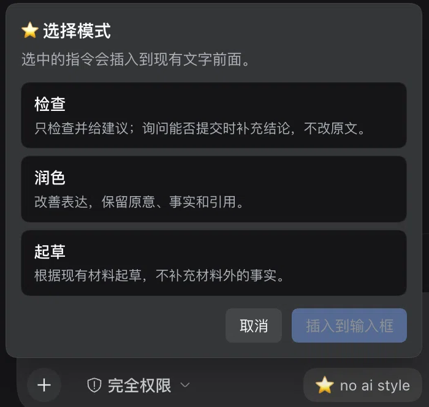

<p align="center">
  
  
</p>

<h3 align="center">No AI Style</h3>

<p align="center">
  <b>自然な表現、忠実な意味。</b><br>
  <sub>学術・専門ライティング向けのエージェントスキル兼 DeepSeek Harness プラグイン</sub>
</p>

<p align="center">
  <a href="https://github.com/01NGVI-QINGYI/no-ai-style/releases"></a>
  <a href="https://awesome-dsh-plugin.com/p/01NGVI-QINGYI/no-ai-style/"></a>
  <a href="LICENSE"></a>
  
</p>

<p align="center">
  <a href="README.md">English</a> ·
  <a href="README.zh-CN.md">中文</a> ·
  <a href="README.ja.md">日本語</a>
</p>

---

## 概要

**No AI Style** は、文章をテンプレートのように見せる機械的な言い回し——冗長な前置き、過剰に重ねられた留保、防衛的な自己弁護——を取り除き、主張そのものは変えません。事実、数値、引用、手法、限界はそのまま保たれ、書き手自身の文体が残ります。

> **変更前：** 明確にするために述べておくと、この機器は USB ポートを 2 つ備えています。
>
> **変更後：** この機器は USB ポートを 2 つ備えています。

## 3 つのモード

| モード | 表示名 | 出力内容 |
| :-- | :-- | :-- |
| `audit` | **確認** | 問題点と改善案のみを提示し、元ファイルは変更しません。提出可否を尋ねた場合は、判定結果と未解決の課題も示します。 |
| `revise` | **推敲** | 意味・事実・数値・引用を保ったまま、指定範囲の表現を整えます。 |
| `compose` | **草稿** | 提供されたメモや根拠のみに基づいて起草し、資料にない事実は追加しません。 |

既定では軽微な修正にとどめ、大幅な書き換えが必要な場合は指示に応じて調整します。原文の言語に合わせて動作し、すでに自然で明快な箇所には手を加えません。

```text
この文章を no-ai-style で確認してください。
no-ai-style で推敲してください。
このメモから no-ai-style で草稿を作ってください。
```

事実関係の正確性を保つため、2 種類のマーカーを使用します。
- `[EVIDENCE GAP]` — 根拠が不足している主張を示し、解消されるまで `ready`（提出可）の判定を保留します。
- `[INTERPRETATION FLAG]` — 解釈が分かれる箇所を示し、著者の確認を求めます。

## 入力欄のショートカット

DSH プラグインは、入力欄のツールバーに ⭐ **no ai style** ボタンを追加します。モードを選択すると、現在の UI 言語（日本語・英語・中国語）に応じた指示が入力済みの下書きの先頭に挿入され、既存の文章はそのまま保たれます。

挿入操作は元に戻す（Undo）ことができます。また、ファイルやコマンドの参照を含む下書きにおいて、旧バージョンの DSH が参照構造を保持できない場合は、参照がプレーンテキスト化されるのを防ぐため挿入を見送ります。

## インストール

### DeepSeek Harness

**アプリから：** **Settings → Plugins** で `github:01NGVI-QINGYI/no-ai-style` を追加し、アプリを再起動します。

**CLI から：** 使用中のプロファイルを `--profile` に指定します（`dsh web` は `web`、デスクトップ版は `desktop`）：

```bash
dsh plugin --profile web add github:01NGVI-QINGYI/no-ai-style
```

プラグインが独自の skill provider を登録するため、プロジェクト・カスタム・ユーザーの各 skill ディレクトリを変更することなく、該当プロファイルの全セッションでスキルが有効になります。

<details>
<summary><b>スキルのみをインストールする（プラグインなし）</b></summary>

<br>

DeepSeek Harness のプロジェクトディレクトリ内で次を実行すると、`.agents/skills` にインストールされます：

```bash
npx skills add 01NGVI-QINGYI/no-ai-style --agent universal --copy
```

</details>

### その他のエージェント

```bash
npx skills add 01NGVI-QINGYI/no-ai-style
```

プロンプトに従って対象エージェントを選択します。プロジェクト単位でインストールする場合は、下記コマンドから `--global` を外してください。

<details>
<summary><b>エージェント別のインストールコマンド</b></summary>

<br>

| Agent | コマンド |
| :-- | :-- |
| Codex | `npx skills add 01NGVI-QINGYI/no-ai-style --global --agent codex` |
| Claude Code | `npx skills add 01NGVI-QINGYI/no-ai-style --global --agent claude-code` |
| Cursor | `npx skills add 01NGVI-QINGYI/no-ai-style --global --agent cursor` |
| Pi | `npx skills add 01NGVI-QINGYI/no-ai-style --global --agent pi` |

手動で導入する場合は、`skills/no-ai-style/` を各エージェントの skills ディレクトリにコピーしてください。

</details>

## ローカル検証スクリプト

外部依存のない Python 3.9+ スクリプトを 2 つ同梱しています。リポジトリのルートで実行できます：

```bash
python3 skills/no-ai-style/scripts/audit_prose.py draft.md --lang auto
python3 skills/no-ai-style/scripts/compare_anchors.py before.md after.md --format json
```

- `audit_prose.py`：定型的な表現、未解決の根拠マーカー、構造上の問題を検出します。
- `compare_anchors.py`：推敲前後のファイルを比較し、数値・単位・日付・引用が維持されているかを確認します。

いずれもローカルで完結し、テキストを外部に送信しません。検出結果は目視確認のための補助情報として扱ってください。閉じられていないコメントやコードフェンスは警告として報告され、`--strict` を指定すると根拠不足マーカーや未閉鎖の記法がある場合に終了コード `1` を返します。

## ライセンス

[MIT](LICENSE) · スキル v1.0 · DSH プラグイン v1.2.2 · 作者 [01NGVI-QINGYI](https://github.com/01NGVI-QINGYI)

本プロジェクトの目的は読みやすく誠実な文章を作成することであり、AI 検出器の回避ではありません。編集規則の詳細は [SKILL.md](skills/no-ai-style/SKILL.md) を参照してください。
