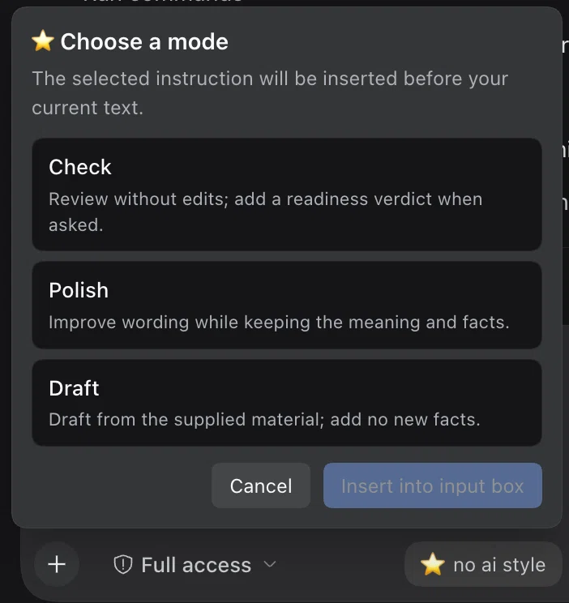
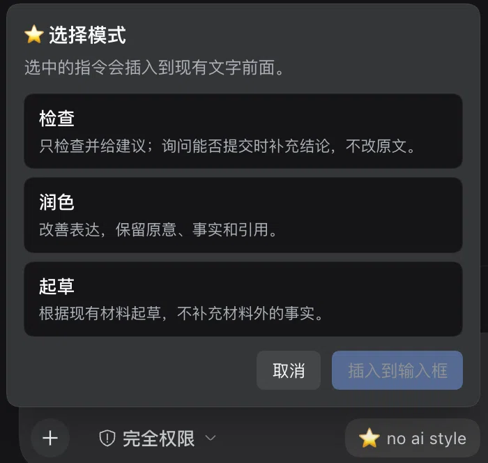

<p align="center">
  
  
</p>

<h3 align="center">No AI Style</h3>

<p align="center">
  <b>Natural writing. Faithful meaning.</b><br>
  <sub>An agent skill and DeepSeek Harness plugin for academic and professional writing</sub>
</p>

<p align="center">
  <a href="https://github.com/01NGVI-QINGYI/no-ai-style/releases"></a>
  <a href="https://awesome-dsh-plugin.com/p/01NGVI-QINGYI/no-ai-style/"></a>
  <a href="LICENSE"></a>
  
</p>

<p align="center">
  <a href="README.md">English</a> ·
  <a href="README.zh-CN.md">中文</a> ·
  <a href="README.ja.md">日本語</a>
</p>

---

## Overview

**No AI Style** strips out the mechanical phrasing that makes prose read like a template—empty lead-ins, stacked hedges, and defensive self-justification—without altering the underlying claims. Facts, numbers, citations, methods, and limitations stay intact, and the voice remains yours.

> **Before:** For clarity, it should be mentioned that the device supports two USB ports.
>
> **After:** The device supports two USB ports.

## Three modes

| Mode | Label | Output |
| :-- | :-- | :-- |
| `audit` | **Check** | Diagnostic findings and suggestions only; source files are never modified. When asked about submission readiness, adds a verdict and any unresolved issues. |
| `revise` | **Polish** | Edited prose within the requested scope, preserving all facts, data, and citations. |
| `compose` | **Draft** | A clean draft built strictly from the notes and evidence you provide. |

Light editing is the default; ask for a deeper rewrite when needed. The skill matches the language of the source text and leaves clear, well-written passages alone.

```text
Use no-ai-style to check this.
Use no-ai-style to polish it.
Use no-ai-style to draft from these notes.
```

Two markers enforce factual accountability:
- `[EVIDENCE GAP]` — flags an unsupported claim and blocks `ready` until the missing source or data is supplied.
- `[INTERPRETATION FLAG]` — marks an ambiguous point that requires author confirmation.

## In the composer

The DSH plugin adds a ⭐ **no ai style** button to the composer toolbar. Selecting a mode prepends the matching instruction to your current draft in the active UI language (English, Chinese, or Japanese) while keeping everything you have already typed.

Insertion supports standard undo. If a draft contains file or command references that an older DSH version cannot preserve during text insertion, the plugin skips insertion rather than flattening those references into plain text.

## Install

### DeepSeek Harness

**In the app:** Go to **Settings → Plugins**, add `github:01NGVI-QINGYI/no-ai-style`, and restart.

**From the CLI:** Pass your active profile to `--profile` (`web` for `dsh web`, or `desktop` for the desktop app):

```bash
dsh plugin --profile web add github:01NGVI-QINGYI/no-ai-style
```

The plugin registers its own skill provider, making the skill available across all sessions in that profile without modifying your project, custom, or user skill directories.

<details>
<summary><b>Install the skill only (without the composer plugin)</b></summary>

<br>

Run this inside your DSH project directory to install into `.agents/skills`:

```bash
npx skills add 01NGVI-QINGYI/no-ai-style --agent universal --copy
```

</details>

### Other agents

```bash
npx skills add 01NGVI-QINGYI/no-ai-style
```

Select your target agent when prompted. Omit `--global` in the commands below to install for the current project only.

<details>
<summary><b>Per-agent commands</b></summary>

<br>

| Agent | Command |
| :-- | :-- |
| Codex | `npx skills add 01NGVI-QINGYI/no-ai-style --global --agent codex` |
| Claude Code | `npx skills add 01NGVI-QINGYI/no-ai-style --global --agent claude-code` |
| Cursor | `npx skills add 01NGVI-QINGYI/no-ai-style --global --agent cursor` |
| Pi | `npx skills add 01NGVI-QINGYI/no-ai-style --global --agent pi` |

For a manual install, copy `skills/no-ai-style/` into your agent's skills directory.

</details>

## Local verification scripts

Two zero-dependency Python 3.9+ scripts run locally from the repository root:

```bash
python3 skills/no-ai-style/scripts/audit_prose.py draft.md --lang auto
python3 skills/no-ai-style/scripts/compare_anchors.py before.md after.md --format json
```

- `audit_prose.py` scans drafts for template phrasing, unresolved evidence markers, and structural issues.
- `compare_anchors.py` checks that numbers, units, dates, and citations remain unchanged between revisions.

Both scripts run entirely offline. Treat their output as review prompts rather than mechanical rules: unclosed comments or code fences trigger warnings, and `--strict` exits with code `1` when unresolved evidence markers or unclosed markup are present.

## License

[MIT](LICENSE) · Skill v1.0 · DSH plugin v1.2.2 · by [01NGVI-QINGYI](https://github.com/01NGVI-QINGYI)

Built for clear, faithful writing—not AI-detector evasion. Full editorial rules are in [SKILL.md](skills/no-ai-style/SKILL.md).
