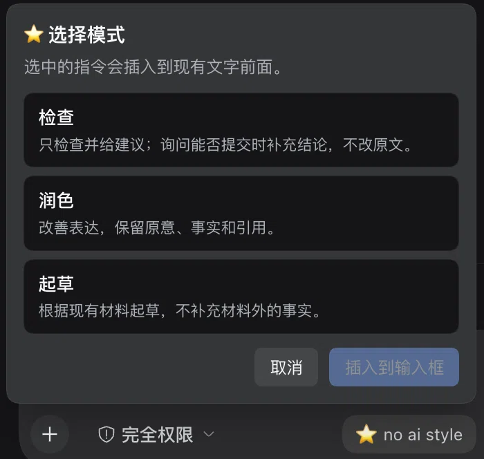

<p align="center">
  
  
</p>

<h3 align="center">No AI Style</h3>

<p align="center">
  <b>Natural writing. Faithful meaning.</b><br>
  <sub>An agent skill and DeepSeek Harness plugin for academic and professional writing</sub>
</p>

<p align="center">
  <a href="https://github.com/01NGVI-QINGYI/no-ai-style/releases"></a>
  <a href="https://awesome-dsh-plugin.com/p/01NGVI-QINGYI/no-ai-style/"></a>
  <a href="LICENSE"></a>
  
</p>

<p align="center">
  <a href="README.md">English</a> ·
  <a href="README.zh-CN.md">中文</a> ·
  <a href="README.ja.md">日本語</a>
</p>

---

## What it does

It removes the phrasing that makes a text read like a template — the throat-clearing, the stacked hedges, the self-justification — and leaves the claims alone. Facts, numbers, citations, methods and limitations survive as written, and the voice stays yours.

> **Before** — For clarity, it should be mentioned that the device supports two USB ports.
>
> **After** — The device supports two USB ports.

## The three modes

| Mode | Name | What you get |
| :-- | :-- | :-- |
| `audit` | **Check** | Findings and suggestions only. Ask whether it is ready to submit and you also get a verdict and the unresolved issues. The source file is never touched. |
| `revise` | **Polish** | An edited version within the scope you asked for. |
| `compose` | **Draft** | A draft built from the notes and evidence you supplied. |

Light editing is the default; ask for a stronger rewrite when you want one. The skill follows the language of the text and leaves passages that already work untouched.

```text
Use no-ai-style to check this.
Use no-ai-style to polish it.
Use no-ai-style to draft from these notes.
```

Two markers keep it honest: `[EVIDENCE GAP]` flags a claim that needs a source and blocks a `ready` verdict, and `[INTERPRETATION FLAG]` flags a reading the author should confirm.

## In the composer

The DSH plugin adds a ⭐ **no ai style** button to the input row. Pick a mode and the matching instruction lands at the front of your draft — in the interface language, Chinese, English or Japanese — with whatever you already typed left intact.

Insertion is undoable. A draft that carries file or command references is refused rather than flattened, so those references survive.

## Install

### DeepSeek Harness

From the app: **Settings → Plugins** → add `github:01NGVI-QINGYI/no-ai-style`, then restart.

From the CLI — `--profile` is the profile you actually run, `web` for the `dsh web` build and `desktop` for the desktop app:

```bash
dsh plugin --profile web add github:01NGVI-QINGYI/no-ai-style
```

The plugin registers its own skill provider, so the skill reaches every session in that profile without touching your project, custom or user skill roots.

<details>
<summary><b>Prefer the skill on its own, without the plugin?</b></summary>

<br>

Run this inside your DSH project; it installs to `.agents/skills`:

```bash
npx skills add 01NGVI-QINGYI/no-ai-style --agent universal --copy
```

</details>

### Any other agent

```bash
npx skills add 01NGVI-QINGYI/no-ai-style
```

Choose your agent when prompted. Omit `--global` for a project install.

<details>
<summary><b>Per-agent commands</b></summary>

<br>

| Agent | Command |
| :-- | :-- |
| Codex | `npx skills add 01NGVI-QINGYI/no-ai-style --global --agent codex` |
| Claude Code | `npx skills add 01NGVI-QINGYI/no-ai-style --global --agent claude-code` |
| Cursor | `npx skills add 01NGVI-QINGYI/no-ai-style --global --agent cursor` |
| Pi | `npx skills add 01NGVI-QINGYI/no-ai-style --global --agent pi` |

To install by hand, copy `skills/no-ai-style/` into your agent's skills directory.

</details>

## Optional checks

Two local scripts, Python 3.9+, no dependencies. Run them from the repository root:

```bash
python3 skills/no-ai-style/scripts/audit_prose.py draft.md --lang auto
python3 skills/no-ai-style/scripts/compare_anchors.py before.md after.md --format json
```

Neither uploads text. Findings still need a human read: an unclosed comment or code fence produces a warning, and `--strict` turns missing-evidence markers or unclosed markup into exit code 1.

## License

[MIT](LICENSE) · skill v1.0 · DSH plugin v1.2.2 · by [01NGVI-QINGYI](https://github.com/01NGVI-QINGYI)

The goal is readable, faithful prose, not AI-detector evasion. Full rules are in [SKILL.md](skills/no-ai-style/SKILL.md).
