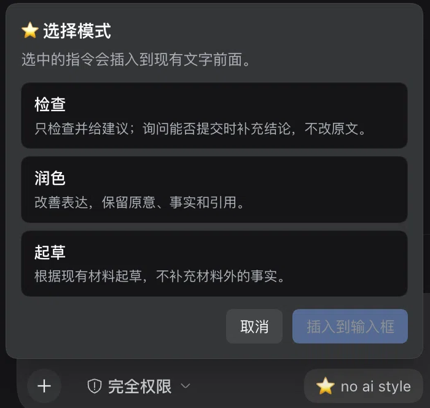
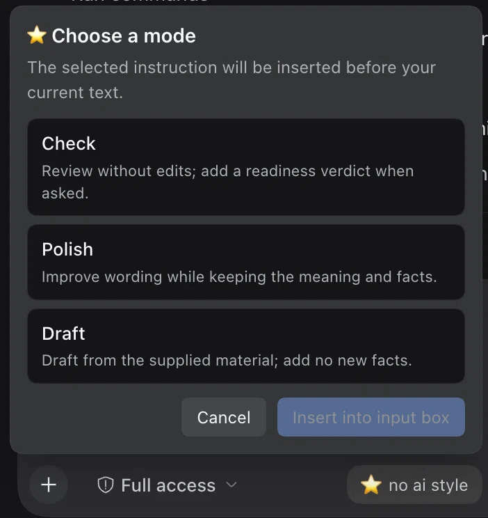

<p align="center">
  
  
</p>

<h3 align="center">No AI Style</h3>

<p align="center">
  <b>自然表达，忠于原意。</b><br>
  <sub>面向学术与专业写作的 Agent 技能与 DeepSeek Harness 插件</sub>
</p>

<p align="center">
  <a href="https://github.com/01NGVI-QINGYI/no-ai-style/releases"></a>
  <a href="https://awesome-dsh-plugin.com/p/01NGVI-QINGYI/no-ai-style/"></a>
  <a href="LICENSE"></a>
  
</p>

<p align="center">
  <a href="README.md">English</a> ·
  <a href="README.zh-CN.md">中文</a> ·
  <a href="README.ja.md">日本語</a>
</p>

---

## 核心作用

**No AI Style** 用于剔除让文章读起来像模板的机械表达——空洞的开场铺垫、层层堆叠的限定词与防御性的自我辩解——同时完整保留原文论断。事实、数据、引用、研究方法与局限性原封不动，行文依然保持作者原有的语气。

> **修改前：** 为了说明清楚，需要指出的是，该设备配有两个 USB 接口。
>
> **修改后：** 该设备配有两个 USB 接口。

## 三种模式

| 模式 | 按钮名称 | 输出结果 |
| :-- | :-- | :-- |
| `audit` | **检查** | 仅列出问题与修改建议，不改动原文件；若询问是否可提交，会给出评估结论与待解决问题。 |
| `revise` | **润色** | 在指定范围内优化表达，严格保留原意、事实、数据与引用。 |
| `compose` | **起草** | 严格基于所给材料起草成文，不补充材料之外的事实。 |

默认采用轻度修改；如需大幅重写可直接说明。技能会自动匹配原文语言，对原本自然通顺的段落不做多余改动。

```text
请用 no-ai-style 检查这段文字。
请用 no-ai-style 润色。
请用 no-ai-style 根据这些材料起草。
```

两类标记用于严守事实边界：
- `[EVIDENCE GAP]` — 标出缺乏依据的断言，并在补齐证据前阻止给出 `ready`（可提交）结论。
- `[INTERPRETATION FLAG]` — 标出存在歧义、需作者确认的解读。

## 输入框快捷按钮

DSH 插件会在输入框工具栏中添加一个 ⭐ **no ai style** 按钮。选择模式后，插件会按当前界面语言（中文、英文或日文）将对应指令插入到现有草稿开头，已输入的内容保持不变。

插入操作支持随时撤销。若当前草稿包含文件或命令引用，而所用旧版 DSH 无法在插入文本时保留这些结构化引用，插件会阻止插入，避免将引用降级为普通文本。

## 安装

### DeepSeek Harness

**应用内安装：** 打开 **Settings → Plugins**，添加 `github:01NGVI-QINGYI/no-ai-style`，重启应用即可。

**命令行安装：** 将 `--profile` 设为当前使用的环境（`dsh web` 使用 `web`，桌面端使用 `desktop`）：

```bash
dsh plugin --profile web add github:01NGVI-QINGYI/no-ai-style
```

插件会注册独立的 skill provider，使技能直接对该 profile 下的所有会话生效，不会修改项目、自定义或用户级 skill 目录。


### 仅安装 Skill（不安装 DSH 输入框插件）

在 DSH 项目目录中运行，将独立技能安装到 `.agents/skills`：

```bash
npx skills add 01NGVI-QINGYI/no-ai-style --agent universal --copy
```

### 其他 Agent

**交互式安装：运行命令后，按提示选择目标 Agent。**

```bash
npx skills add 01NGVI-QINGYI/no-ai-style
```

**指定 Agent 安装：选择对应的命令即可。**

以下命令默认**全局安装**；如需仅在当前项目安装，删除 `--global` 参数。

**Codex**

```bash
npx skills add 01NGVI-QINGYI/no-ai-style --global --agent codex
```

**Claude Code**

```bash
npx skills add 01NGVI-QINGYI/no-ai-style --global --agent claude-code
```

**Cursor**

```bash
npx skills add 01NGVI-QINGYI/no-ai-style --global --agent cursor
```

**Pi**

```bash
npx skills add 01NGVI-QINGYI/no-ai-style --global --agent pi
```

**手动安装：** 将 `skills/no-ai-style/` 复制到目标 Agent 的 skills 目录。

## 本地校验脚本

仓库内置两个零第三方依赖的本地脚本（需 Python 3.9+），可在仓库根目录下直接运行：

```bash
python3 skills/no-ai-style/scripts/audit_prose.py draft.md --lang auto
python3 skills/no-ai-style/scripts/compare_anchors.py before.md after.md --format json
```

- `audit_prose.py`：扫描草稿中的套话模式、未解决的证据标记与结构问题。
- `compare_anchors.py`：对比修改前后的文本，核验数值、单位、日期与引用标注是否一致。

脚本完全在本地运行，不上传任何文本。输出结果仅供人工复核参考：未闭合的注释或代码块会触发警告；添加 `--strict` 参数后，若存在未解决的证据标记或未闭合语法，脚本将以退出码 `1` 结束。

## 许可证

[MIT](LICENSE) · 技能 v1.0 · DSH 插件 v1.2.2 · 作者 [01NGVI-QINGYI](https://github.com/01NGVI-QINGYI)

本项目旨在提升文本的可读性与严谨性，而非规避 AI 检测器。完整编辑规则请参阅 [SKILL.md](skills/no-ai-style/SKILL.md)。
